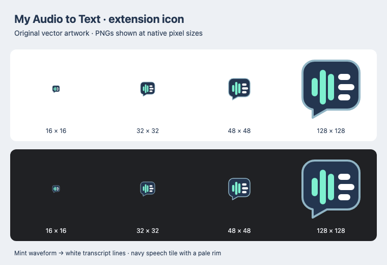
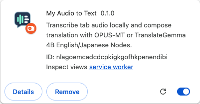

# Custom extension icon — Issue #343

The original icon combines a mint waveform and white transcript lines inside a
navy speech tile. A pale outline preserves the silhouette on dark themes. The
small 16 px design grid keeps the artwork simple without lettering, external
images, fonts, or third-party marks. The editable master, four PNG exports, and
regeneration instructions live in [extension/icons](../../extension/icons/README.md).

Both `icons` and `action.default_icon` reference
`extension/icons/icon-{16,32,48,128}.png` relative to the packaged root manifest.
The existing directory copy includes the assets and master; no build-script
change was needed. The existing action title and other manifest settings are
preserved.

## Validation

- `npm test`: **982 passed**, no failures or skips. The existing packaging test
  now checks both icon maps, each packaged file against its source and inventory,
  PNG signature/chunk CRCs, exact RGBA dimensions, decompressed image data, and
  inclusion of the SVG master.
- Prepared all pinned runtime assets with the repository's existing preparation
  scripts, then ran `npm run build:extension`: **passed**, 264 packaged files,
  zero model weights. No asset-integrity checks were bypassed.
- `npx playwright test --config playwright.extension.config.js tests/extension/icons.spec.js`:
  **1 passed**. Loads the actual `dist/chrome-extension` package in an isolated
  Chromium profile, checks the installed action icon configuration and title,
  fetches/decodes all four PNGs, and checks native `chrome://extensions` rendering.
  The native icon's decoded pixels match the configured PNG exactly. Repeats
  these checks after Chrome's native reload, with no manifest or runtime errors.
  The profile enables Developer mode, as required for native unpacked-extension
  reloads. Earlier harness attempts omitted this and were corrected.
- `npx playwright test --config playwright.extension.config.js tests/extension/extension.spec.js --grep 'loadable MV3 extension'`:
  **2 passed**, covering existing worklet and fallback audio/capture behavior.
- `git diff --check`: passed.

## Visual inspection

Inspected all four PNGs at native sizes on white and dark (`#202124`)
backgrounds. The waveform and transcript lines remain distinct, the outline
remains visible, and the artwork is not clipped. The PNGs are rendered directly
from the vector at their target sizes rather than resizing a larger bitmap.

Also inspected the native extension-management icon captured after reload:

## Remaining native-toolbar visual check

A separate isolated headed Chrome for Testing session successfully loaded the
production package, enabled Developer mode, pinned the action, and reloaded the
extension. Capturing that owned browser window with macOS `screencapture` failed
with `could not create image from window`. The pinned native toolbar itself
therefore has **not been visually inspected**; the automated check establishes
action-icon registration and successful asset decoding, and the native
management icon is verified above.

To complete this visual acceptance item, load/reload `dist/chrome-extension` in
a headed Chrome window, pin **My Audio to Text**, and confirm the custom waveform
and transcript tile appears in the toolbar. The all-size light/dark artwork
inspection is already complete. This is a remaining pre-merge visual check,
not a post-merge-only requirement.
