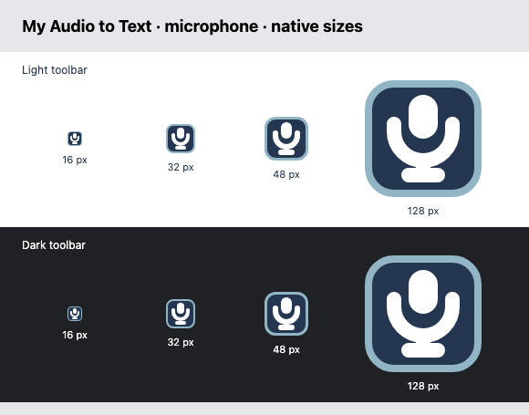

# Microphone extension icon — Issue #345

Replaced the waveform/transcript speech tile from #343 with one dominant white
microphone on a navy rounded square. The pale rim separates the tile from dark
toolbars. The capsule, cradle and stand are drawn on a 16 px grid with a 4×6 px
capsule, 2 px support strokes and open space around the capsule. There is no
lettering, transcript detail, waveform or speech-bubble tail at any size.

The editable [SVG master and generation instructions](../../extension/icons/README.md)
produce separate 16×16, 32×32, 48×48 and 128×128 PNGs directly from the vector.
Both existing manifest maps retain their paths. The build continues copying the
entire icon directory into `dist/chrome-extension/extension/icons/`; extension
behavior, permissions and naming are unchanged.

## Validation

- `node scripts/generate-extension-icons.mjs`: generated all four PNGs.
- `node scripts/generate-extension-icons.mjs --check`: all four committed PNGs
  match freshly rendered exports byte for byte with the locked Playwright browser.
- `npm test`: **989 passed**, no failures or skips. The packaging test verifies
  four distinct icon paths and file hashes, exact RGBA dimensions, PNG signatures
  and chunk CRCs, decompression and row-filter decoding, transparent corners,
  substantial opaque content, white foreground and dark background. It checks
  both manifest maps, source/package byte equality, inventory sizes/hashes and
  inclusion of the master. Transparent or solid-color placeholders fail.
- `node --test tests/extension.test.js`: **31 passed** after the final test edit.
- Prepared the pinned, weight-free runtimes with the existing preparation
  scripts, then ran `npm run build:extension`: **passed**, 265 packaged files,
  zero model weights. Verified all four production PNGs against source bytes
  and their inventory sizes/SHA-256 hashes. No integrity checks were bypassed.
- `npm run test:extension -- tests/extension/icons.spec.js`: **1 passed**.
  Loaded the production package in an isolated Chromium profile, verified both
  installed manifest maps and the existing action title, and fetched/decoded
  every PNG at its expected dimensions. The native `chrome://extensions` image
  matched the configured PNG pixel for pixel before and after native reload,
  with no manifest or runtime errors.
- `git diff --check`: passed.
- Additional capture smoke command:
  `npm run test:extension -- tests/extension/extension.spec.js --grep 'loadable MV3 extension'`:
  **2 failed** waiting for `#model-status` to become `Ready` within 5 seconds.
  Both cases were still downloading the unchanged Silero/ReazonSpeech models.
  This command exercises capture/model preparation beyond the icon change;
  neither its fixtures nor the model-loading behavior were modified.

## Visual inspection

Inspected the four exports at actual pixel sizes on white and `#202124`
backgrounds. The microphone is the only subject, its capsule and open cradle
remain distinct at 16 px, and the rim remains visible on the dark background.
This preview uses the committed PNGs at device scale 1, without enlarging them.

Per Issue #345, headed Chrome, pinning, a manual toolbar screenshot and human
visual sign-off are not completion requirements. Further owner-requested visual
refinements belong in a separate issue.
