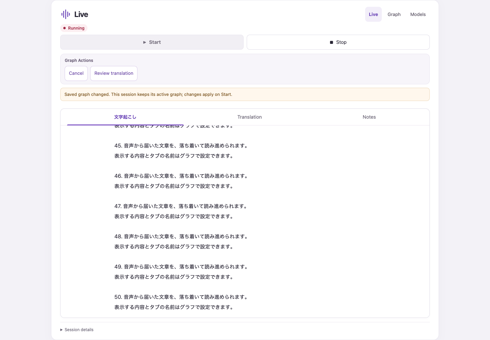
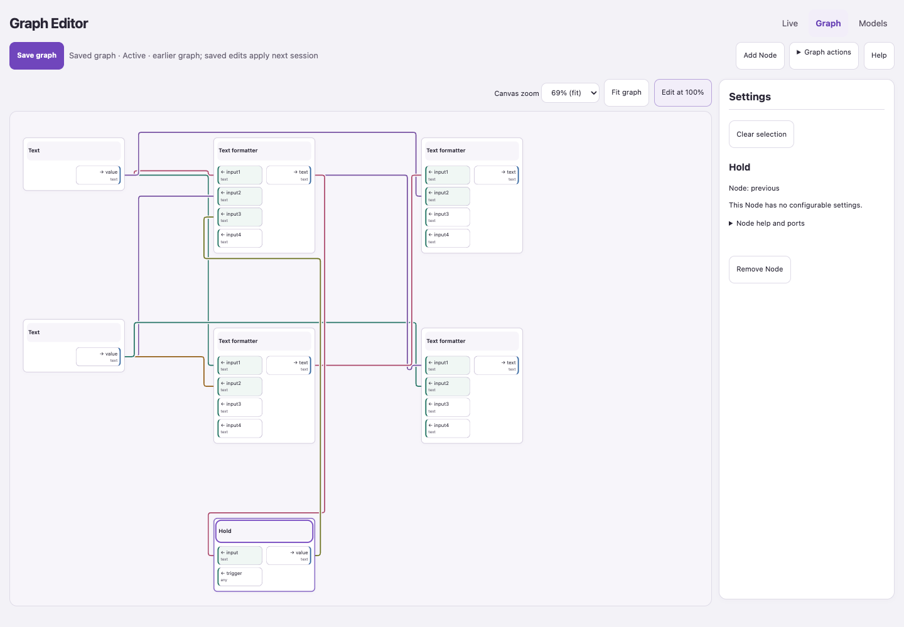
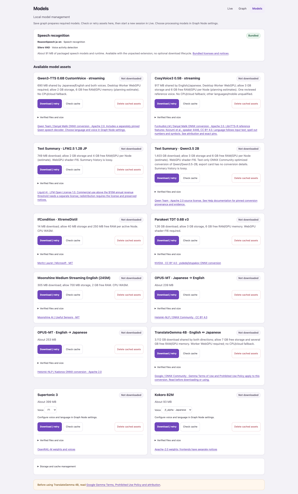
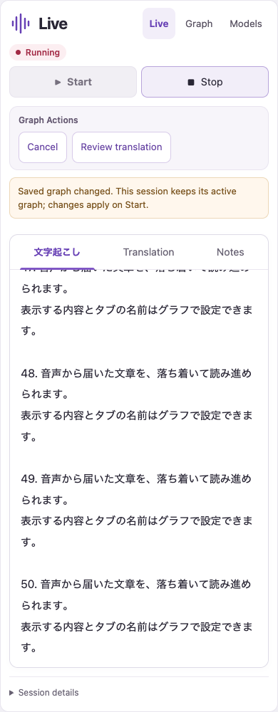
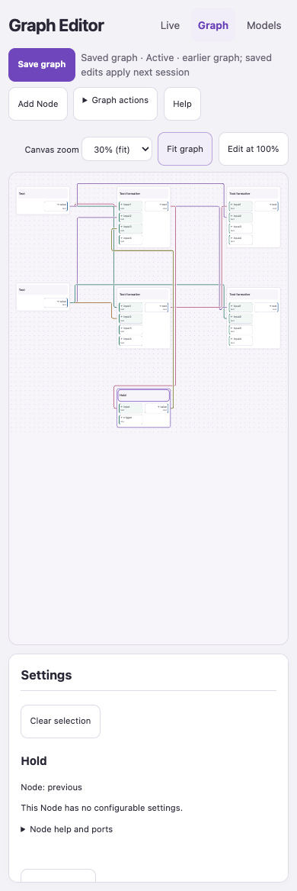
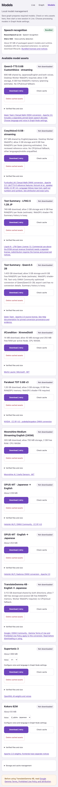

# Shared light UI for Graph and Models (#229)

Validated on 2026-11-06 with Playwright 1.63.0, Chromium 153 and WebKit 26.6 on macOS arm64.

## Result and visual comparison

`extension/app.css` holds Live's existing light palette, typography, navigation, controls, focus and status tokens. Live keeps its reading layout; its only navigation change is an explicit current-page entry. Graph and Models opt into that shared system with separate layout styles. The cache demo retains its legacy theme.

| Live · 1440px | Graph · 1440px | Models · 1440px |
| --- | --- | --- |
|  |  |  |

| Live · 390px | Graph · 390px | Models · 390px |
| --- | --- | --- |
|  |  |  |

The screenshots show real extension pages and production UI code. The existing graph fixture supplies model-free Live text/actions and small, checksum-verified local assets for cache workflows; model titles, resource estimates and notices are unchanged. Live's “saved graph changed” notice is expected: the screenshot test saves the dense routing graph while the earlier Live graph continues running. The graph Button caption “Cancel” is fixture data, not a session-cancel control.

Visual review confirmed the common pale lavender background, white surfaces, violet controls, lilac-gray borders and typography. Deliberate layout differences remain: Live uses its existing white reading shell; Graph uses the full window with an independently scrollable canvas and inspector; Models uses two columns on desktop and one column at 800px and below. At narrow widths, Graph's tools wrap and its scrollable inspector sits below the canvas. Fit is an overview; the existing “Edit at 100%” action restores readable editing and the focused port.

Additional evidence:

- [Dense graph at 100%](ui-229-dense-100.png), [selected wire](ui-229-wire-selected.png), [hovered wire](ui-229-wire-hover.png). Background-colored crossing gaps remain intact; card avoidance, parallel lanes, fan-out and Hold feedback retain their actual geometry. Keyboard wire focus uses the thicker highlighted path, avoiding an SVG bounding-box outline through unrelated cards.
- Node palette: [desktop](ui-229-palette-1440.png), [390px](ui-229-palette-390.png).
- Help and model requirements: [desktop](ui-229-help-1440.png), [390px](ui-229-help-390.png).
- Models: [streaming progress and cancellation](ui-229-models-downloading-390.png), [retryable error](ui-229-models-error-390.png). These are controlled fixture downloads, not claims of downloading full model weights.

## Validation

All applicable cases below passed after correcting stale test assumptions. No runtime, cache policy, graph schema, manifest or model-selection behavior changed.

- `npm test`: **791 passed**, no skips.
- `npm run build:extension`: passed after preparing the pinned ASR, translation, Whisper, Zipformer, optional-ASR, summary and TTS assets with their existing package scripts. The new stylesheets are included in the unpacked MV3 package.
- Browser command below: **94 passed**, **2 intentional skips**. Chromium covers both historical routing screenshot generators; WebKit skips those duplicate screenshot-only cases. Both engines run the functional routing/interaction checks.
- **60 distinct MV3 cases passed** across targeted batches, rerunning affected failures after corrections. Coverage includes native mouse/touch wire selection and reconnect/detach, keyboard navigation, inspector stability, variable Display inputs/tab labels, Button/Hold behavior, Save/Load/Import/Export, validation, draft conflict/recovery, zoom/Fit, model preparation, cancellation/retry, corruption/eviction/quota recovery, cross-page locking, Chrome profile restart and storage persistence.
- Native Live navigation opens Graph and Models, then focuses the existing Live window without stopping audio, requesting a second capture grant or retargeting the stream. The no-existing-Live path retains its toolbar-action guidance.
- New layout checks inspect document overflow, 44px navigation/action targets, expanded model file paths, licenses and dialogs at 390/800/1440px. Existing zoom checks verify editing at 25/50/75/100/150% and Fit, including very large graphs.
- Computed color checks verify at least **4.5:1** for model text, metadata, licenses, status chips, errors and enabled actions, plus graph headings/ports/contracts; at least **3:1** for visible and selected wires against the canvas. Keyboard focus recovery and disabled/progress/error states are exercised with actual controls. This is targeted contrast/interaction verification, not a full accessibility conformance audit.

Browser regression command:

```sh
npx playwright test tests/browser/extension-layout.spec.js tests/browser/graph-routing.spec.js tests/browser/graph-traceability.spec.js tests/browser/live-ui.spec.js tests/browser/shared-ui.spec.js tests/browser/display-tabs.spec.js tests/browser/hold-feedback.spec.js --workers=2
```

MV3 files exercised (through `npm run test:extension -- ...`):

```text
tests/extension/display-tabs.spec.js
tests/extension/graph-actions.spec.js
tests/extension/graph-hold-feedback.spec.js
tests/extension/graph-interactions.spec.js
tests/extension/graph-models.spec.js
tests/extension/graph-routing.spec.js
tests/extension/layout.spec.js
tests/extension/live-ui.spec.js
tests/extension/model-cache.spec.js
tests/extension/shared-ui.spec.js
```

Also ran `extension.spec.js` and `simple-layout.spec.js` with `--grep 'Live navigation|Graph stays'` (2 passed). The broader inference/capture suites were not run; their behavior is outside this styling change. Optional real-model inference and physical-device testing were not performed.

Initial runs exposed old dark-theme expectations, the old Simple navigation caption, a removed Live Cancel control, fixed default-graph counts from before the current coalescing topology, and a historical Hold height from before its trigger port. Tests now check the current UI and exact unchanged graph data. The historical routing comparison still checks original placements, widths and port endpoints, and verifies paths against current card bounds.

To regenerate the 15 committed screenshots after building:

```sh
UPDATE_SHARED_UI_SCREENSHOTS=1 npm run test:extension -- tests/extension/shared-ui.spec.js
```
